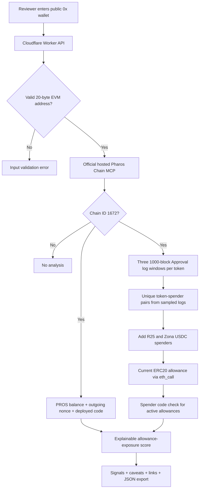

# Wallet Risk Checker — Architecture and threat-model limits

## Trust model and data provenance

- Only Pharos Mainnet chain ID **1672** is accepted.
- Official hosted Chain MCP endpoint is **fixed** in source. User cannot select RPC URLs.
- The app never accepts a private key, recovery phrase, RPC authorization token, transaction calldata or raw signed transaction.
- Any scanned owner is a **public address** and can be reviewed by third parties. No wallet connection is required.
- Requests are rate-limited at the Worker edge and limited to short JSON payloads.
- The MCP session closes after each scan; there are no third-party enrichment calls or additional APIs.

## What the chain can and cannot prove

A past ERC-20 `Approval(owner,spender,value)` event is **not** definitive evidence that the spender has remaining funds authorization. The remaining allowance can be reduced by `transferFrom` or revoked in a later block. The scanner therefore calls **live** `allowance(owner,spender)` on the token contract and marks errors as `unavailable` instead of guessing.

The scanner samples only 3×1,000 separate blocks per known token. It cannot claim that the wallet lacks approvals outside these windows. To check two known spender addresses even when their Approval events are not sampled, it explicitly reads current USDC allowances for the R25 and Zona protocol contracts. Their presence in the known-spender list **does not** imply they are audited or inherently safe.

The scanner **does not** run a blacklisting database, identify scam wallet owners, detect fake token contracts, audit spender bytecode, verify multisig policy, find Permit2 signatures or infer fraudulent activity from balances or nonce counts.

## Risk scoring logic

This is a **permission exposure severity index**, not personal reputation.

| Condition observed and verified | Added exposure points |
|---|---:|
| Unlimited current ERC-20 allowance granted to an EOA spender | 52 |
| Unlimited allowance granted to a smart contract spender | 34 |
| Finite nonzero allowance granted to an EOA | 24 |

Score is capped at 100. It does not compare absolute amount to token value (prices are not available), does not invent wallet age, and does not penalize a zero balance or high nonce as fraud. It only suggests manually reviewing/reducing current unnecessary approvals with a trusted wallet.

## Evidence and limitations

- Deterministic tests include crafted Approval logs, valid and invalid owners, unique-pair detection, high-risk but **simulated** infinite allowances, and intentionally failing token log provider.
- A separate live integration test fetches a real wallet balance, nonce, block, bounded logs and current known-spender allowances through the hosted Chain MCP.
- A deployed production test verifies the same live path over the public Worker.
- A score of zero with limited scope is not proof of safety, and the UI says so. Production never uses synthetic balances or fabricated Approval events.
